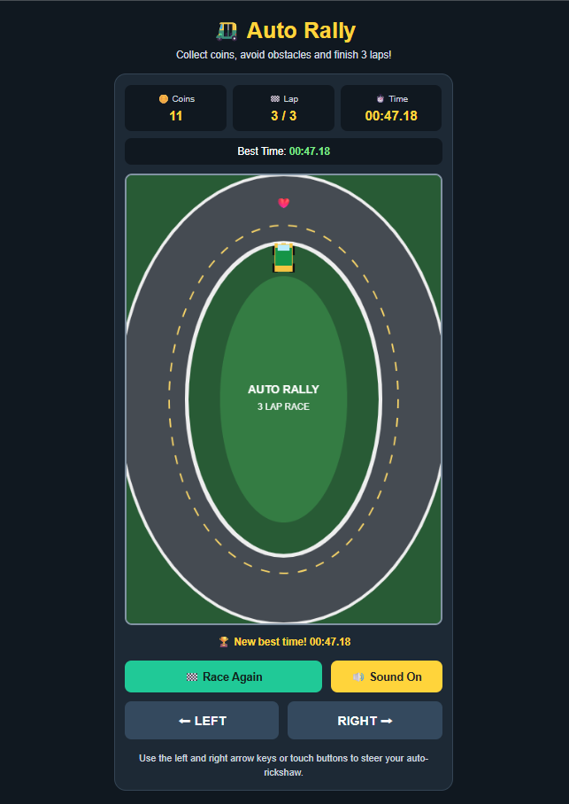

# 🛺 Auto Rally – Rickshaw Racing Game

A fun, offline auto-rickshaw racing game built using HTML, CSS and JavaScript.

Collect coins, avoid obstacles, activate power-ups and complete three laps around a looping racing track!

## 🎮 Features

- Driveable auto-rickshaw with keyboard and touch controls
- Looping racing track
- Coin collection system
- Obstacles and collision detection
- Three lives per race
- Shield power-up for temporary protection
- Three-lap racing challenge
- Live race timer
- Best-time saving using browser local storage
- Sound effects with mute option
- Game Over and Race Again functionality
- Responsive design for smaller screens
- Works offline after the project files are available

## 🕹️ Controls

| Control | Action |
|---|---|
| Left Arrow / A | Steer left |
| Right Arrow / D | Steer right |
| LEFT button | Touch steering left |
| RIGHT button | Touch steering right |
| Start Race | Start or restart the race |
| Sound On / Sound Off | Toggle sound |

## 🛠️ Technologies Used

- HTML5
- CSS3
- JavaScript
- HTML Canvas
- Browser Local Storage
- Web Audio API

## 📂 Project Structure

```text
Auto-Rally/
│
├── index.html
├── style.css
├── script.js
├── README.md
├── .gitignore
│
└── docs/
    └── gameplay.png
```

## 🚀 How to Run

1. Download or clone this repository.
2. Open the project folder.
3. Double-click `index.html`.
4. Press Start Race.
5. Use the arrow keys or touch buttons to steer.

No installation or internet connection is required to play once the files are available locally.

## 🧪 Tested Features

- [x] Game opens in the browser
- [x] Racing animation works
- [x] Keyboard steering works
- [x] Touch steering works
- [x] Coins can be collected
- [x] Obstacles trigger collisions
- [x] Lives decrease after crashes
- [x] Shield power-up activates
- [x] Three-lap race and timer work
- [x] Best time survives page refresh
- [x] Sound and mute controls work
- [x] Game Over and restart work

## 📸 Gameplay Screenshot



## 📌 Project Information

**Project Name:** Auto Rally  
**Project Type:** Offline Racing Game  
**Version:** 1.0  
**Status:** Functional testing completed

Built as part of my Week 2 project work.
